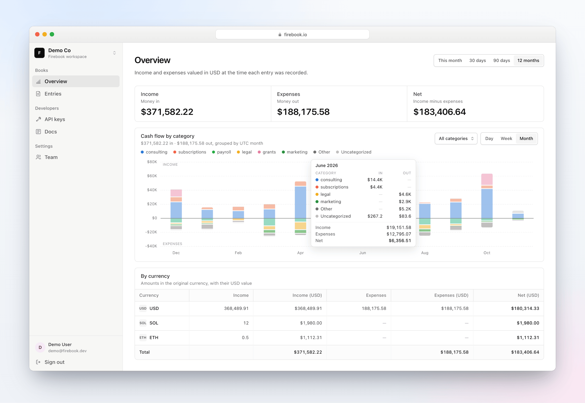

<p align="center"></p>

<h1 align="center">Firebook</h1>

<p align="center"><strong>Accounting for crypto companies.</strong><br>Record income and expenses from your backend, valued in USD the moment they happen.</p>

<p align="center"><a href="https://render.com/deploy?repo=https://github.com/fiberevm/firebook"></a></p>

<p align="center"></p>

## What it is

Crypto businesses get paid and pay out in tokens whose price moves every minute, so "how much did we make this month?" is surprisingly hard to answer. Firebook is a small ledger built for that question.

Your backend sends each payment to the Firebook API as it happens: an amount, a currency, whether it's income or an expense, and optionally a category, tags and metadata. Firebook records the USD value at that moment, so your books reflect what the money was actually worth when it moved, not what it's worth today.

- **USD value at the time of the entry.** ETH is priced live from the Uniswap V3 USDC/ETH pool, and USD is 1:1. For anything else, or when you already know the exact value, pass `usdValue`.
- **Cash flow by category.** The overview breaks income and expenses down by category per day, week or month, and you can switch categories on and off.
- **An entry feed you can slice.** Filter by `key:value` tags, and open any entry to see its value, tags and metadata.
- **Built for teams.** Multiple organizations, admin and member roles, and API keys scoped to each organization.
- **An MCP server for AI agents.** Connect Claude Code, Cursor or any MCP client to record entries and ask about your books. See [MCP server](#mcp-server).
- **Self-hostable.** Sign in with your own identity provider over OIDC (Cloudflare Access, Okta, Google…) and turn passwords off. See [Self-hosting](#self-hosting-sign-in-and-sso).

```bash
curl https://api.firebook.io/v1/entries \
  -H "Authorization: Bearer $FIREBOOK_API_KEY" \
  -H "Content-Type: application/json" \
  -d '{ "amount": 0.5, "currency": "eth", "type": "income", "category": "consulting", "tags": ["client:acme"] }'
```

## Repository

A [Bun](https://bun.sh) workspaces monorepo.

| Path              | What                                                                                                            |
| ----------------- | --------------------------------------------------------------------------------------------------------------- |
| `apps/api`        | Express 5 API (`cmd/api.ts`), which also serves the built dashboard, and the ETH price worker (`cmd/worker.ts`) |
| `apps/web`        | React 19 + Vite + Tailwind v4 dashboard, a static build served by the API in production                         |
| `apps/marketing`  | Static landing page (Vite + Tailwind, no JS). `VITE_APP_URL` sets where the sign up button points               |
| `packages/db`     | Drizzle schema, migrations and Postgres client                                                                  |
| `packages/shared` | API response types and zod request schemas used by both apps                                                    |

## Running it locally

You need [Bun](https://bun.sh) 1.4+ and Postgres.

```bash
bun install
cp apps/api/.env.example apps/api/.env     # set DATABASE_URL, DATABASE_TEST_URL, JWT_SECRET
cp apps/web/.env.example apps/web/.env.local
createdb accounting && createdb accounting_test
```

### Commands (from the repo root)

```bash
bun run dev          # API on :3000 (runs migrations on boot) + web on :5173
bun run worker       # refreshes the ETH price every 10s
bun run dev:marketing  # landing page on :5174
bun run test         # API tests against DATABASE_TEST_URL (tables are truncated!)
bun run typecheck    # all packages
bun run build        # all packages
bun run start        # production: API + built dashboard on :3000
bun run db:generate  # new migration after editing packages/db/src/schema.ts
bun run format       # prettier
```

`TEST_NETWORK=1 bun run test` also runs the test that reads the live Uniswap pool over `RPC_URL`.

## API

Create an API key on the **API keys** page, then:

```
POST /v1/entries
Authorization: Bearer <api key>

{ "amount": 100.31, "currency": "eth", "type": "income", "category": "consulting", "usdValue": 254012.5, "tags": ["client:acme"], "metadata": { "invoice": "A-1" } }
```

Accepts a single entry or an array. `usdValue` (optional, ≥ 0) sets the entry's total USD value; when omitted it is computed from the current price × `amount`. Only `usd` and `eth` are priced automatically, so `sol`, `bnb` and `pol` entries need `usdValue`. `category` (optional, free text up to 255 characters) groups entries in the overview chart.

## MCP server

The API includes an [MCP](https://modelcontextprotocol.io) server at `/mcp` (Streamable HTTP), so AI agents can work with your books. It uses the same API keys as `/v1`, and the key decides which organization the agent sees.

```bash
claude mcp add --transport http firebook https://<your-firebook>/mcp --header "Authorization: Bearer <api key>"
```

Other clients take the same URL and header, e.g. `{ "mcpServers": { "firebook": { "type": "http", "url": "https://<your-firebook>/mcp", "headers": { "Authorization": "Bearer <api key>" } } } }`. The dashboard's **Docs** page shows both with your URL and key filled in.

| Tool                     | What it does                                                                                |
| ------------------------ | ------------------------------------------------------------------------------------------- |
| `record_entries`         | Record one or more entries, valued in USD like `POST /v1/entries` (`usdValue`, `category`…) |
| `list_entries`           | Entries newest first, filtered by date, tags or category, with the total count              |
| `get_statement`          | Total income, expenses and net in USD, with a per-currency breakdown                        |
| `get_category_breakdown` | USD totals per category and type, per day, week or month                                    |
| `delete_entry`           | Delete an entry recorded by mistake                                                         |

## Self-hosting: sign-in and SSO

Sign-in is configured with a JSON file: `firebook.config.json` in the API's working directory, or the path in `FIREBOOK_CONFIG`. Without one, email and password sign-in and sign up are on, and SSO is off. The API checks the file on boot and refuses to start if it is invalid.

```json
{
  "apiUrl": "https://books.example.com",
  "auth": {
    "password": { "enabled": false },
    "oidc": {
      "name": "Cloudflare Access",
      "issuer": "https://your-team.cloudflareaccess.com/cdn-cgi/access/sso/oidc/your-client-id",
      "clientId": "your-client-id",
      "allowedEmailDomains": ["example.com"]
    }
  }
}
```

| Option                          | Default                                             |                                                                                                                                       |
| ------------------------------- | --------------------------------------------------- | ------------------------------------------------------------------------------------------------------------------------------------- |
| `apiUrl`                        | `RENDER_EXTERNAL_URL`, else `http://localhost:3000` | Public URL of the API (and the dashboard it serves). The redirect URI to register with your provider is `<apiUrl>/auth/oidc/callback` |
| `appUrl`                        | `apiUrl`, or `http://localhost:5173` in development | Where SSO sends people back to. Only set it if you host the dashboard somewhere else                                                  |
| `auth.password.enabled`         | `true`                                              | Email and password sign-in. Turning it off also turns off sign up                                                                     |
| `auth.password.signup`          | `true`                                              | Self-service sign up with a password                                                                                                  |
| `auth.oidc.name`                | `single sign-on`                                    | Button label: "Continue with …"                                                                                                       |
| `auth.oidc.issuer`              |                                                     | OIDC issuer; `<issuer>/.well-known/openid-configuration` must exist                                                                   |
| `auth.oidc.clientId`            |                                                     |                                                                                                                                       |
| `auth.oidc.clientSecret`        | `OIDC_CLIENT_SECRET` env                            | Prefer the env var, so the secret stays out of the file                                                                               |
| `auth.oidc.scopes`              | `["openid", "email", "profile"]`                    |                                                                                                                                       |
| `auth.oidc.autoCreateUsers`     | `true`                                              | Create a Firebook user on first SSO sign-in. When off, only existing users can sign in                                                |
| `auth.oidc.allowedEmailDomains` | any                                                 | Only these email domains can sign in with SSO                                                                                         |

SSO uses the authorization code flow with PKCE, state and nonce, and verifies the ID token. People are matched to Firebook users by email, so an existing password user can also sign in with SSO. An ID token with `email_verified: false` is rejected.

**Cloudflare Access:** in Zero Trust, go to Access → Applications → Add an application → SaaS, pick OIDC, and set the redirect URL to `<apiUrl>/auth/oidc/callback`. Copy the client ID, client secret and issuer into the config. Any other OIDC provider (Okta, Google, Authentik, Keycloak…) works the same way. See `apps/api/firebook.config.example.json`.

## Deploy

[](https://render.com/deploy?repo=https://github.com/fiberevm/firebook)

The button creates everything in [`render.yaml`](render.yaml): the **api** service, which also serves the dashboard, the price **worker**, the **marketing** landing page and a Postgres database. The API and worker share one Docker image (`apps/api/Dockerfile`, built from the repo root), which builds the dashboard in. The API runs migrations when it starts, and `JWT_SECRET` is generated for you. Once it's deployed, open the api service's URL to sign up.

The landing page's sign up buttons need the dashboard's URL, which Render only knows after the first deploy. Leave `VITE_APP_URL` empty when you create the blueprint, then set it to the api service's URL (e.g. `https://api-xxxx.onrender.com`) and redeploy marketing.

The API and worker use Render's Starter plan and the database Basic-256mb, which are paid; change the `plan` fields in `render.yaml` to pick others. The database accepts no outside connections until you add your IP to `ipAllowList`. To use SSO, add `firebook.config.json` (see [above](#self-hosting-sign-in-and-sso)) as a [Secret File](https://render.com/docs/configure-environment-variables#secret-files) on the api service, then set `FIREBOOK_CONFIG=/etc/secrets/firebook.config.json` and `OIDC_CLIENT_SECRET` there. `apiUrl` defaults to the service's Render URL, so you only need to set it for a custom domain.

To run it anywhere else: `docker build -f apps/api/Dockerfile .`, then run the image with `DATABASE_URL` and `JWT_SECRET` (and the same image with `bun apps/api/cmd/worker.ts` for the worker). Without Docker, `bun run build && bun run start` serves the API and dashboard on `:3000`.
